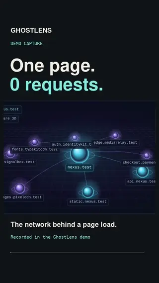

# GHOSTLENS

**X-Ray the Invisible Internet**

GHOSTLENS is a local-first network observatory for browser HAR captures. Inspect an interactive 3D map of contacted hostnames, find slow or failed requests, and classify first- and third-party traffic without sending captures to a server.

<p align="center">
  <a href="https://github.com/rohanbeeps/ghostlens/raw/refs/heads/main/docs/media/ghostlens-demo.mp4">
    
  </a>
</p>

<p align="center"><a href="https://github.com/rohanbeeps/ghostlens/raw/refs/heads/main/docs/media/ghostlens-demo.mp4">Download the silent demo · 18 seconds</a></p>

## Run locally

Open the standalone `GhostLens.html` in your browser to use the portable edition. It contains the interface, worker, fonts, and synthetic demo. To generate this file from source, run `npm ci` and `npm run build:offline`, then open `dist/GhostLens.html` directly.

Use Node.js 22.12+ from a supported LTS line and npm. Browser regression tests cover Chromium, Firefox, and Playwright WebKit. The graph uses WebGL 2 when available and includes a software renderer.

```sh
npm ci
npm run dev
```

Open the localhost URL printed by Vite. The bundled, synthetic Nexus capture loads on startup.

```sh
npm test                 # Run the Vitest suite
npm run test:watch       # Re-run tests on changes
npm run build            # Type-check and write dist/
npm run build:offline    # Generate dist/GhostLens.html
npm run preview          # Serve the production build locally
```

The standard build is a static site. Run `npm run preview` from the project folder, then open the URL it prints on the computer running the server. For deployment, serve the contents of `dist/` over HTTP(S). Generate the portable file after the standard build when you need both outputs in the same directory.

## Explore a capture

1. Open the Network panel in your browser’s developer tools and record traffic. Enable **Preserve log** if the workflow navigates between pages.
2. Export a HAR 1.2 file. Prefer your browser’s sanitized export option when available.
3. Choose **Import HAR** or drop the file onto GHOSTLENS. Use **Load demo** to return to the bundled [synthetic HAR](public/demo.har).
4. Drag the graph to orbit. Use the zoom and reset buttons in either renderer. WebGL also supports scroll and pinch to zoom. Choose **Requests** or **Bytes** to change node sizing. Select a node or hostname label to filter the Request Inspector.
5. Use **Requests** to search redacted URLs and filter by response family, resource type, party, or a selected hostname. Select a request to see the URL, measurements, and individual timing phases.
6. Use **Analytics** to inspect status distribution, timings, domain breakdown, and findings. Findings open the matching rows in the inspector. Select a request to see its individual timing phases.
7. Use **Compare** to load a baseline and a candidate. Group by endpoint or hostname, sort by the largest change, then select a side to inspect matching requests or open its topology.
8. In **Analytics**, choose **Masked report** to preview, copy, or download a Markdown summary with placeholder hostnames.

## Reading the data

- **Domain and party.** Nodes represent hostnames. The first recorded document is the primary hostname. Without a document marker, the first HTML response or earliest usable request takes its place. Hostnames on the same registrable domain are first-party. Private suffixes are included in the public suffix lookup. Lines show co-occurrence with the primary hostname and carry no initiator or dependency information.
- **Transferred bytes.** GHOSTLENS prefers the recorded response transfer size, including browser extensions, and falls back to known response header plus wire-body sizes. Totals aggregate known measurements and use binary units such as KiB and MiB. Decoded content size is excluded.
- **Timing.** The waterfall aligns requests to the earliest recorded start. GHOSTLENS uses HAR total time when present and falls back to fully recorded phases when possible. TLS is a subphase of connect. Browser cache behavior and HAR exporter differences can leave timings, sizes, or status unavailable.
- **Comparison.** Endpoint groups use method, origin, and redacted path. Query values are ignored, and routes with the same redacted path may be combined. The table shows baseline and candidate values alongside measurement coverage. A missing delta indicates incomplete coverage or unavailable timing data. Capture the same workflow under comparable conditions to make the deltas easier to interpret.
- **Findings.** These are threshold-based starting points. GhostLens groups endpoints with at least three calls, shows reported waits of at least 500 ms, finds transfers of at least 512 KiB, and identifies third-party HTTP errors. The HAR wait phase includes network time.
- **Limits.** Imports are capped at 40 MiB and 40,000 entries. The graph shows up to 22 individual hostnames. The extra node and its legend button filter the inspector to all grouped hostnames. The request and domain tables retain all parsed entries within the capture limit. Without WebGL 2, a software renderer keeps the 3D topology and camera controls available.

## Capture privacy

The parser runs in a browser worker. No capture upload, analytics telemetry, external AI, or automatic requests to captured URLs are used. The raw HAR is never persisted. Opening a capture creates a redacted in-memory model. Clear it from the workspace or close the tab to discard it.

GHOSTLENS removes URL usernames and passwords, query strings, and fragments from its request model and discards headers, cookies, and bodies. It masks common token patterns in URL paths on a best-effort basis. Hostnames, filenames, and unrecognized path segments can still contain sensitive information. Treat original HAR files and screenshots of real captures as sensitive. Use synthetic captures when reporting bugs.

For screen sharing, open **Privacy & help** and enable **Mask capture details**. The app replaces filenames, hostnames, and URLs with placeholders and hides custom HTTP methods. Switching the mode clears the active search and domain selection. Traffic counts, timings, and topology stay visible, so review what those statistics reveal before sharing. This setting affects the displayed view for the current tab.

Markdown reports always use placeholder hostnames and aggregate measurements. Review any remaining traffic statistics before posting a report. The report viewer offers download and text selection when clipboard access is unavailable.

## Source layout

```text
src/
  App.tsx                 Workspace, navigation, and capture interactions
  components/             Topology, analytics, inspector, and dialogs
  lib/                    HAR worker, parsing, aggregation, graph layout, tests
  styles.css              Tailwind entry point, tokens, and component styles
public/demo.har           Synthetic 128-request capture
tests/browser/            Production browser regression tests
scripts/                  Offline packaging and synthetic benchmarks
.github/workflows/ci.yml  Unit, build, and browser checks
```

React, TypeScript, Vite, Three.js, React Three Fiber, Drei, Tailwind CSS, Lucide, Vitest, and Playwright. Production builds include the application license, bundled dependency notices, and HAR parser notices. See [CONTRIBUTING.md](CONTRIBUTING.md) for development and release checks, [SECURITY.md](SECURITY.md) for vulnerability reporting, and [LICENSE](LICENSE) for the MIT license.
